# Phase Tracker

Live record of every phase: what it contains, how it flows, and exactly where it
stands. **This file is updated as work happens** — no phase item is marked done
until its gates pass.

| Legend | Meaning                        |
| ------ | ------------------------------ |
| ⬜     | not started                    |
| 🟡     | in progress                    |
| ✅     | done — gates passed            |
| ⛔     | blocked — see the blocker note |

Every item follows the 18-step feature workflow in
[05-feature-workflow.md](05-feature-workflow.md). The step numbers in the
checklists below refer to it.

---

## Phase index

Every item at a glance. Detail, flow diagram, and 18-step checklist for each is
further down.

| ID      | Item               | Covers                                                                                                       | Status | Depends on | Blocked by                                |
| ------- | ------------------ | ------------------------------------------------------------------------------------------------------------ | ------ | ---------- | ----------------------------------------- |
| 0.0     | Architecture setup | Next.js, Tailwind, shadcn/ui, app shell, routes, tooling, docs                                               | 🟡     | —          | —                                         |
| 0.1.1   | Auth — frontend    | Signup, login, logout, forgot/reset password, email-verification screens, validation, loading + error states | ✅     | 0.0        | —                                         |
| 0.1.2 A | User model         | `users` table, identity fields, uniqueness, OAuth-only accounts, RLS                                         | ⬜     | 0.0        | Supabase project                          |
| 0.1.2 B | Session management | Create/read/revoke sessions, cookie flags, expiry, refresh                                                   | ✅     | A          | — (Supabase-managed, D1)                  |
| 0.1.2 C | Password handling  | Hashing, constant-time verify, rate limiting, lockout                                                        | ⬜     | A          | Supabase project                          |
| 0.1.2 D | Email verification | Token issue, verify link, resend + cooldown, expiry                                                          | ⬜     | A          | Email provider · unverified-user policy   |
| 0.1.2 E | Password reset     | Request, single-use token, update password, revoke all sessions                                              | ⬜     | A, B, C    | Email provider                            |
| 0.1.2 F | OAuth support      | Provider redirect, callback, account linking, collision handling                                             | ⬜     | A, B       | Provider choice · linking policy          |
| 0.1.2 G | Access control     | Server-side guards, roles, RLS mirroring, wire real session into the UI guards                               | ⬜     | A, B, D    | Session strategy · unverified-user policy |

**Build order within 0.1.2:** S (done) → A → C → B → D → E → G → F. Identity and password
handling come before sessions; access control before OAuth, since OAuth issues
sessions that access control must already understand.

### Progress

| Scope                      | Done   | In progress | Not started | Blocked          |
| -------------------------- | ------ | ----------- | ----------- | ---------------- |
| Phase 0.1 — Authentication | 2 of 8 | 0           | 6           | 6 (see Blockers) |

---

# Phase 0 — Production Foundation

**Build the platform itself.**

Phase 0 is not scaffolding or a prototype — it is devstep as a real, running
product. "Production" sets the bar: things persist, CI runs, the app deploys,
and errors are visible. A screen that cannot save is not foundation, it is a
mockup of one.

> **Result: a user can create and manage a project.**
> Stated by the project owner 2026-08-13. That is the gate for the whole of
> phase 0 — a real user completing the loop, not "the screens exist".

## Position as of 2026-08-19

**The phase-0 result is met on the local stack**: a real user can sign up, sign
in, create a workspace and a project, import a folder, and save the scan —
everything persists in the local Supabase stack (OrbStack + `supabase` CLI).
Auth is live end to end: Supabase-managed sessions, signup/login/logout/reset/
verify server actions with CSRF + rate-limit/brute-force guards, and the route
guards are on (`NEXT_PUBLIC_AUTH_ENABLED=true` in `.env.local`). GoTrue
signups now mirror into `public.users` via a trigger (BUG-022), so real users
can create workspaces. The activity feed reads events back, the import screen
loads the saved scan, and the canvas service enforces workspace permissions.
The suite stands at **605 passing tests** (final review fix round). What still
separates the local result from a production one: a cloud Supabase project, a
production email sender, a repository with CI, and a deploy — see
[blocker.md](blocker.md).

| Needed for "production foundation"   | State                                    |
| ------------------------------------ | ---------------------------------------- |
| Database and persistence             | ✅ local stack (cloud pending — B1 🔵)  |
| Authentication that issues a session | ✅ local (cloud pending)                 |
| CI running on every push             | ⬜ blocked on B6 (no repository)         |
| Deployed and reachable               | ⬜ blocked on B6, Vercel                 |
| Errors visible in production         | ⬜ Sentry not installed                  |
| UI, validation, and domain logic     | ✅ built and tested                      |

The 2026-08-13 position below is kept as history.

## Position as of 2026-08-13

**The result is not met, and cannot be until storage exists.**

Each 0.x below has delivered its UI, validation, and pure logic, all tested.
The suite now stands at **250 passing tests** across auth security, route
policy, workspace permissions, the project wizard, the dashboard's progress,
health, and next-action logic, and the codebase scanner. None of it persists.
A user can walk the create flow end to end and watch it refuse to save.

Blocker **B1** was the single item standing between that state and the phase
result — resolved locally 2026-08-18, see [blocker.md](blocker.md).

## 0.0 Architecture setup — 🟡

Covered in [06-status.md](06-status.md) step 01. Next.js, Tailwind, shadcn/ui,
app shell, route groups, tooling, documentation.

---

## 0.05 Database & environment (build-order step 02) — ✅ 2026-08-18

Per plan `docs/superpowers/plans/2026-08-18-local-database-persistence.md`.
Supabase local stack running (OrbStack + `supabase` CLI); env module extended
with `DATABASE_URL`, `SUPABASE_URL`, `SUPABASE_ANON_KEY`,
`SUPABASE_SERVICE_ROLE_KEY`, `NEXT_PUBLIC_SUPABASE_URL`,
`NEXT_PUBLIC_SUPABASE_ANON_KEY`; `parseEnvSchema` extracted and tested
(545 tests green). Drizzle installed (`drizzle-orm`, `postgres`, `drizzle-kit`,
`dotenv` — B5 cleared, `npm audit` 0 vulnerabilities); the single Drizzle
client lives in `src/features/database/server.ts` (server-only); connection
smoke test green — `npm run db:smoke` prints `[{"ok":1}]`. Wave 1 schema,
migrations, RLS next in build order. RLS fix landed: member-check policies
previously subqueried `workspace_members` directly, which recursed under RLS
(BUG-017, "infinite recursion detected" for every anon query); all member
checks now go through a `SECURITY DEFINER` helper (`public.is_workspace_member`),
and policies are `drop policy if exists` + `create`, so `db:setup` is
re-runnable. Verified by executing as the anon role: all six tables return
`count 0` with no error, and a JWT-claim positive test sees exactly the
member's rows.

Wave 2 landed 2026-08-18 (Task 4): `codebases`, `codebase_scans`,
`detected_technologies`, `detected_features` added to `schema.ts` with
cascading FKs, unique indexes (codebase per project; name per codebase),
JSONB `evidence` defaults `[]`, and relations; migration
`drizzle/migrations/0001_salty_ben_grimm.sql` generated and applied.
`supabase/migrations/0002_wave2_rls.sql` enables RLS on the four tables with
member-read policies through `is_workspace_member`, and grants SELECT to
anon/authenticated (BUG-018 — Supabase local default ACLs do not cover new
public tables). `npm run db:tables` lists all 10 tables. Anon verification
repeated for wave 2: member JWT claims see the fixture rows, an outsider sees
none, no recursion errors. `db:setup` stays re-runnable (`drop policy if
exists` + idempotent grants).

| #   | Item                          | Status | Notes                                                        |
| --- | ----------------------------- | ------ | ------------------------------------------------------------ |
| A   | Local stack                   | ✅     | OrbStack + `supabase` CLI; Auth, Postgres, Mailpit on 54321/54322/54324 |
| B   | Drizzle + env module          | ✅     | `drizzle-orm`/`postgres`/`drizzle-kit` (B5); `DATABASE_URL` + Supabase vars via `@/lib/env`; client cached on `globalThis` |
| C   | Wave 1 schema + migration     | ✅     | 6 tables, cascading FKs, unique indexes, `deleted_at` soft delete on workspaces/projects; `0000_*.sql` |
| D   | Wave 2 schema + migration     | ✅     | 4 codebase tables, JSONB `evidence`, relations; `0001_*.sql` |
| E   | RLS waves 1+2                 | ✅     | `is_workspace_member` SECURITY DEFINER helper (BUG-017), idempotent policies, SELECT grants to anon/authenticated (BUG-018) |
| F   | Setup script                  | ✅     | `npm run db:setup` (migrations then RLS), `npm run db:tables`, `npm run db:smoke` — all re-runnable |

**Gate:** `npm run db:setup` applies migrations + RLS cleanly, `npm run
db:tables` lists all 10 tables, anon-role verification sees member rows only,
and typecheck + lint + test + build all pass — ✅ 2026-08-18, re-verified with
the full gate run 2026-08-19 (Task 11).

---

## 0.1 Authentication

### The whole picture

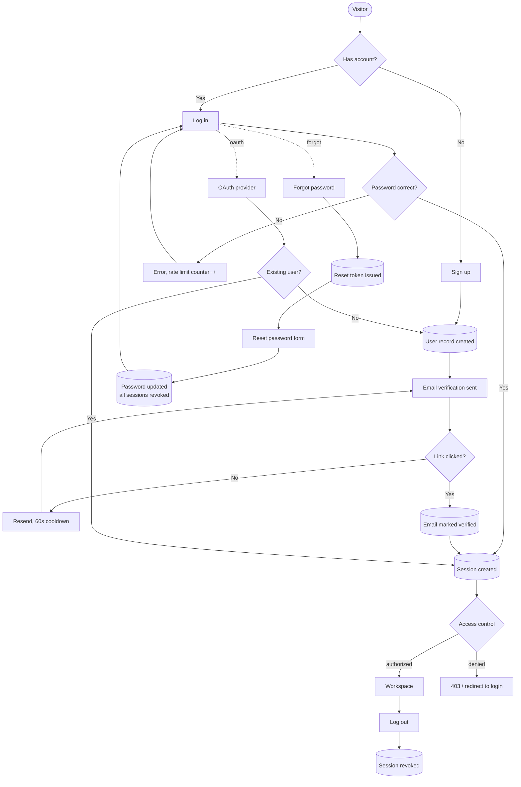

### 0.1.1 Frontend — ✅

Delivered 2026-08-13. Screens, validation, and every visual state for signup,
login, logout, forgot password, reset password, and email verification. Detail
and the honest list of what is _not_ real in
[06-status.md](06-status.md#step-03--detail-phase-01-frontend).

Deliberately deferred to the backend: session handling, real route protection.
`RequireAuth` / `RequireGuest` render states but enforce nothing.

### 0.1.2 Backend — 🟡 item B done; D–G deferred

Seven items. Item B is done — see below. Items A and C are effectively
covered by Supabase-managed auth (D1): GoTrue owns the user record and
password hashing, so the app-level user model and password modules stay
unbuilt (the argon2 `lib/password.ts` remains available if self-managed
hashing is ever wanted). Item D (email verification) and E (password reset)
run against the Supabase local sender — the D2 path, see blocker B3: fine
for development, switch to a production sender before launch. F (OAuth) and
G (access control) stay deferred (provider choice B7; unverified-user
policy B4).

---

#### S. Security primitives — ✅

Delivered 2026-08-13, test-driven. Six modules, **70 tests for this item**. Complete
and exported from `@/features/auth/server`. Rate limiting, brute-force
lockout, and CSRF are wired into the signup/login server actions (Task 6);
password hashing and session policy still wait for items A and B.

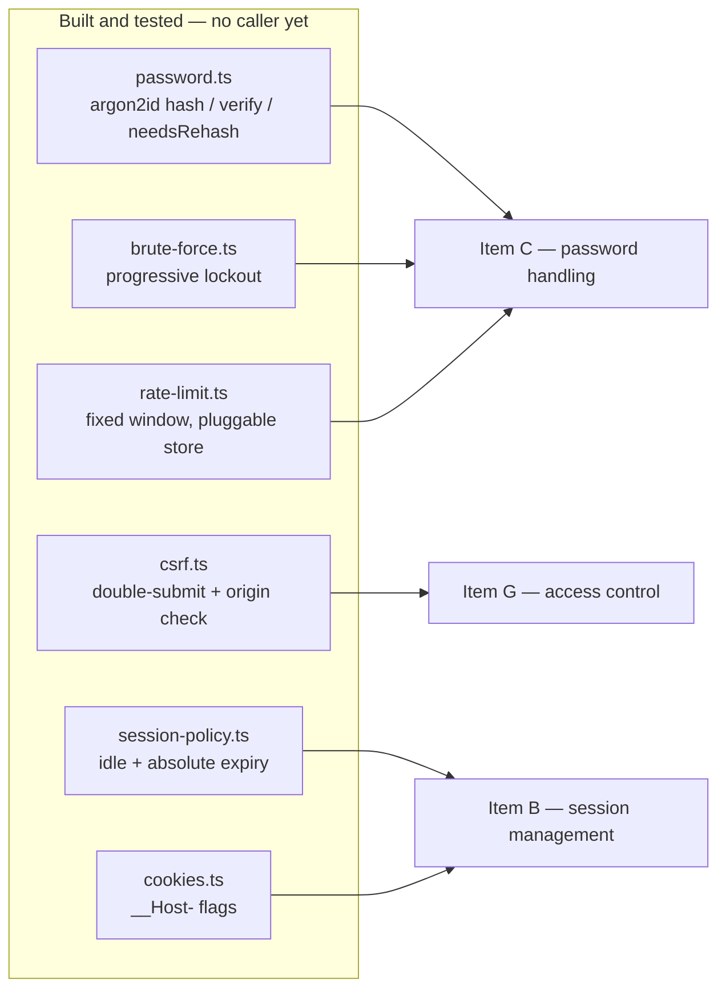

| Module                  | Covers                                                               | Tests |
| ----------------------- | -------------------------------------------------------------------- | ----- |
| `lib/password.ts`       | argon2id, OWASP params (m=19456, t=2, p=1), needs-rehash detection   | 8     |
| `lib/csrf.ts`           | Double-submit token, timing-safe compare, parsed-origin check        | 15    |
| `lib/rate-limit.ts`     | Fixed window, pluggable store, peek/reset, pruning                   | 10    |
| `lib/brute-force.ts`    | Progressive lockout doubling per failure, capped, cleared on success | 13    |
| `lib/session-policy.ts` | Idle timeout (7d) and absolute lifetime (30d), both enforced         | 9     |
| `lib/cookies.ts`        | `__Host-` prefix, httpOnly, secure, sameSite lax, maxAge conversion  | 15    |

**Decisions made here**

- **argon2id** over bcrypt — memory-hard, resists GPU attack; `@node-rs/argon2`
  ships prebuilt binaries that work on Vercel.
- **Two session limits, not one** — sliding idle alone lets an active attacker
  hold a stolen session forever; the absolute cap is what stops that.
- **`sameSite: "lax"`, not `"strict"`** — strict breaks arriving from a
  verification email. Lax still withholds the cookie from cross-site POSTs,
  and the CSRF token covers the rest.
- **`secure` is unconditional**, including in development — `__Host-` requires
  it, so a dev exception would make the cookie silently vanish.
- **Server-only boundary** — these live in `@/features/auth/server`, never the
  client barrel, and `password.ts` imports `server-only` so a mistaken client
  import fails the build instead of shipping argon2 to the browser.

**Two security bugs caught while building this** — BUG-002 and BUG-003 in
[bug.md](bug.md). The first (brute-force failure counts wiped by store pruning)
produced no error of any kind; only a test asserting the lockout actually
engages found it.

**Known limitation:** `MemoryRateLimitStore` is per-process. On serverless or
multiple instances the effective limit multiplies by the instance count. Swap
in a shared Postgres or Redis store before this is load-bearing — the
`RateLimitStore` interface exists for exactly that.

---

### 0.1.3 Integration — 🟡 guards built, storage deferred

Delivered 2026-08-13. Both enforcement layers exist, are tested, and are
**inert by default** — `NEXT_PUBLIC_AUTH_ENABLED` is unset, so behaviour is
unchanged. Enforcing before a login flow exists would redirect every protected
route to a page that cannot issue a session, locking the app permanently.

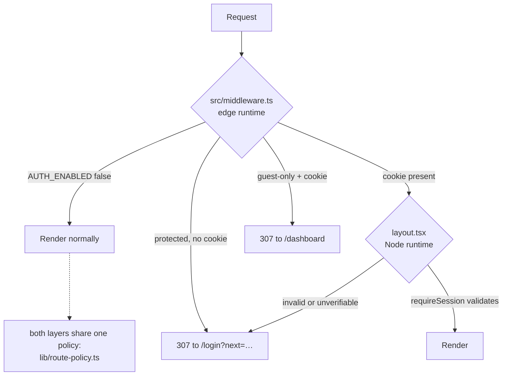

| Piece                                      | File                                           | State                       |
| ------------------------------------------ | ---------------------------------------------- | --------------------------- |
| Route policy — pure, shared by both layers | `lib/route-policy.ts`                          | ✅ 16 tests                 |
| Master switch                              | `lib/auth-enabled.ts`                          | ✅                          |
| Edge middleware — cookie presence          | `src/middleware.ts`                            | ✅ verified both states     |
| Layout guards — session validation         | `server/session.ts`                            | ✅ provider registered (Task 5); guard live once AUTH_ENABLED set |
| Section layouts calling the guard          | `app/{dashboard,projects,settings}/layout.tsx` | ✅                          |
| Auth screens calling `requireGuest`        | `app/(auth)/layout.tsx`                        | ✅                          |

**Verified, both states**

|                           | Switch off (default) | Switch on                                         |
| ------------------------- | -------------------- | ------------------------------------------------- |
| `/dashboard`              | 200                  | 307 → `/login?next=%2Fdashboard`                  |
| `/projects?filter=active` | 200                  | 307 → `/login?next=%2Fprojects%3Ffilter%3Dactive` |
| `/projects/abc?tab=x`     | 404                  | 307 — caught by middleware alone                  |
| `/login`, `/signup`, `/`  | 200                  | 200                                               |

**Design notes**

- **Middleware is not the security boundary.** It runs on the edge runtime and
  can only see whether a cookie exists — a forged cookie passes it. The layout
  guard validates the session and is the real check. Middleware exists to avoid
  rendering a protected page for an obviously signed-out visitor.
- **One policy, two enforcement points.** `decideRoute` is pure and I/O-free so
  the edge and the Node runtime cannot drift apart.
- **Open-redirect safety.** `?next=` accepts only same-origin relative paths;
  an absolute or protocol-relative URL falls back to `/dashboard`.
- **Fails closed.** A present-but-unverifiable cookie throws rather than being
  treated as valid.

**Two bugs found here** — BUG-009 (middleware never loaded; wrong file
location for a `src/` project) and BUG-010 (session lookup threw before
checking for a cookie). See [bug.md](bug.md).

**The gate flag is flipped (Task 11, 2026-08-19).** `NEXT_PUBLIC_AUTH_ENABLED`
is `true` in `.env.example` and `.env.local`; the session provider registered
in Task 5 (`src/lib/server/init.ts`) reads the session from Supabase's own
cookie, and the layout guards now enforce it — verified live by the Task 11
smoke test (signup, sign-in, protected routes redirect signed-out visitors). A
present-but-unverifiable cookie still fails closed.

---

#### A. User model — ⬜

The `users` table plus everything hanging off identity. Wave 1 of
[03-database.md](03-database.md).

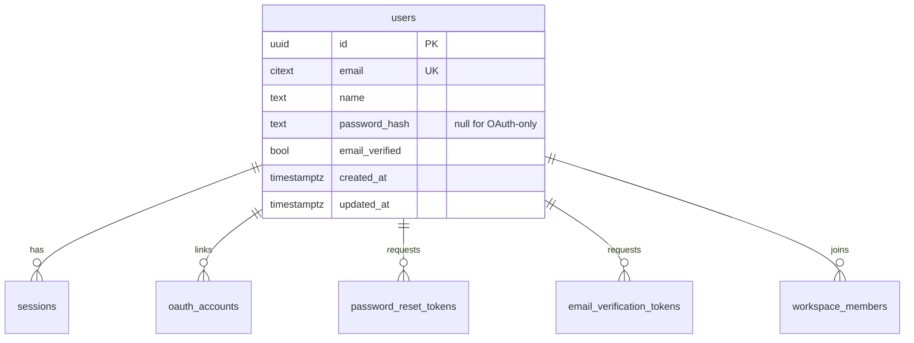

| Step | Item                                                           | Status |
| ---- | -------------------------------------------------------------- | ------ |
| 01   | Requirement — identity fields, uniqueness, OAuth-only accounts | ⬜     |
| 04   | Schema + Drizzle model + migration                             | ⬜     |
| 04   | Row Level Security policies                                    | ⬜     |
| 08   | Zod schema shared with the existing form schemas               | ⬜     |
| 10   | Tests — constraints, uniqueness, RLS                           | ⬜     |

**Open decisions:** primary key type (uuid vs bigserial); soft delete or hard;
whether email is stored case-insensitively (`citext`) or normalized on write.

---

#### B. Session management — ✅ 2026-08-18 (gate passed 2026-08-19)

Chosen implementation: **Supabase-managed sessions** (decision D1). GoTrue
issues the session, holds it in its own `sb-*` cookies (httpOnly, secure,
sameSite), and handles expiry, sliding refresh (`enable_refresh_token_rotation`),
and revocation — the diagram below shows the shape the app relies on, with
`getSession()` standing in for GoTrue's cookie. The app side maps a Supabase
session to `AuthSession` and fails closed on unverified users (D3 gate).

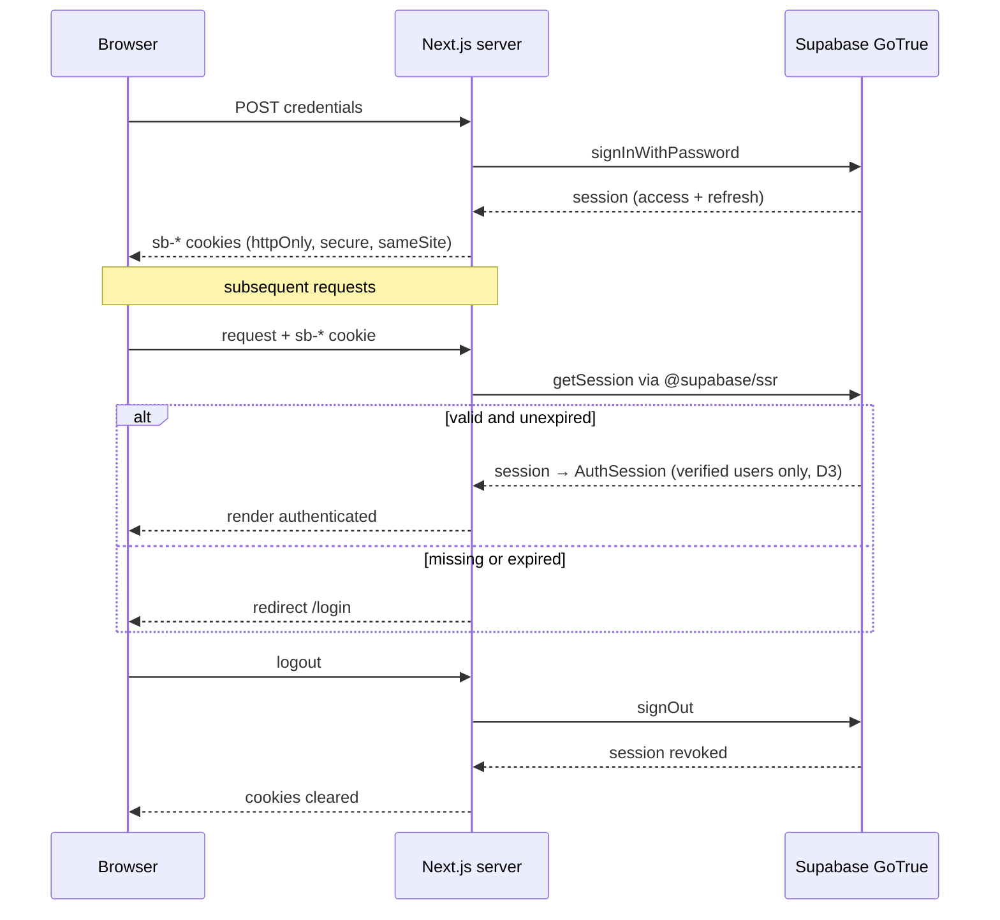

| Step | Item                                                                 | Status |
| ---- | -------------------------------------------------------------------- | ------ |
| 01   | Requirement — lifetime, refresh, revocation, concurrent devices      | ✅     | Chosen: Supabase-managed (D1); expiry 1h, refresh rotation on, revocation on password change (GoTrue) |
| 05   | Session read helper usable from Server Components and Route Handlers | ✅     | `getSession()` via `server/session.ts` + `session-provider.ts` (Task 5, 2 tests) |
| 05   | Login / logout server actions                                        | ✅     | signup, login, logout, reset, verify actions (Tasks 6–7; 10 tests in `actions.test.ts`) |
| 06   | Expiry, sliding refresh, revoke-all-on-password-change               | ✅     | Handled by GoTrue (`jwt_expiry = 3600`, refresh rotation) |
| 07   | Replace the frontend placeholder calls with the real client          | ✅     | Every auth form calls a real server action; `lib/placeholder.ts` remains only as a dead file (deletion tracked in blocker.md) |
| 09   | Cookie flags: httpOnly, secure, sameSite, path, max-age              | ✅     | GoTrue `sb-*` cookies; app's own `__Host-` policy documented in `lib/cookies.ts` (item S) |
| 10   | Tests — expiry, revocation, tampered cookie                          | ✅     | Provider mapping incl. unverified → null (D3), 2 tests; `cookies.ts` flags, 15 tests |

**Decisions resolved:** Supabase-managed sessions (D1); hard gate for
unverified users (D3).

---

#### C. Password handling — ⬜

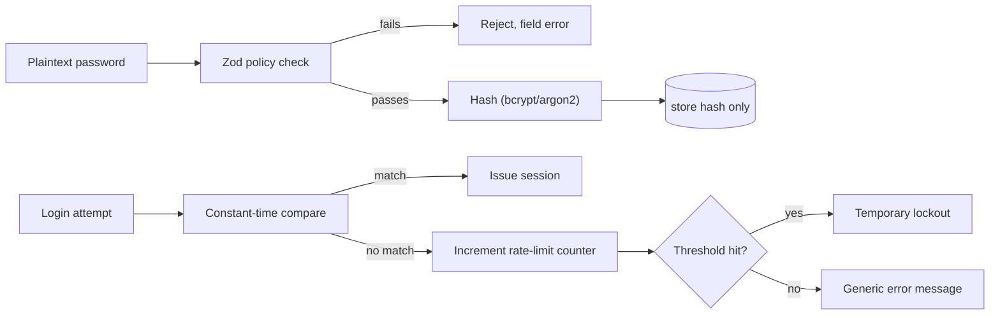

| Step | Item                                                             | Status |
| ---- | ---------------------------------------------------------------- | ------ |
| 01   | Requirement — algorithm, cost factor, rotation on login          | ⬜     |
| 06   | Hash on signup, verify on login, rehash when cost changes        | ⬜     |
| 06   | Rate limiting and lockout on repeated failures                   | ⬜     |
| 09   | Generic failure messages — never reveal whether the email exists | ⬜     |
| 10   | Tests — hash never returned, timing-safe compare, lockout        | ⬜     |

**Rule:** plaintext passwords are never logged, never stored, never returned in
any response or error.

---

#### D. Email verification — ⬜

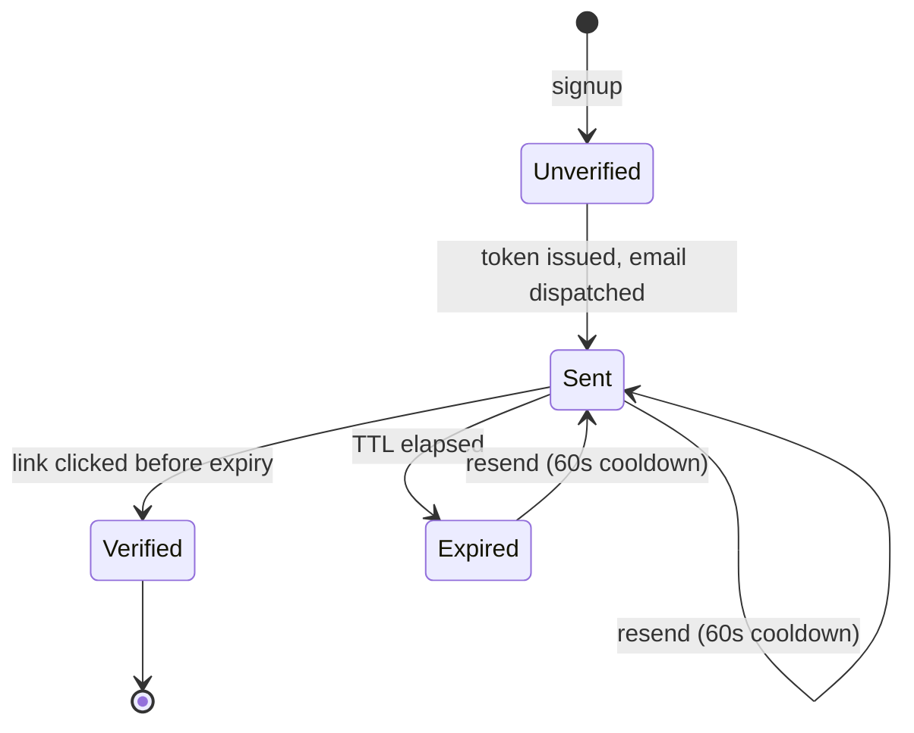

| Step | Item                                                           | Status |
| ---- | -------------------------------------------------------------- | ------ |
| 01   | Requirement — TTL, resend limits, what unverified users may do | ⬜     |
| 04   | `email_verification_tokens` — single-use, hashed at rest       | ⬜     |
| 05   | Route handler for the verification link                        | ⬜     |
| 05   | Resend action, server-side cooldown enforcement                | ⬜     |
| 06   | Consume token on use; expire the rest for that user            | ⬜     |
| 10   | Tests — expired token, reused token, wrong user                | ⬜     |

**Open decision:** can an unverified user sign in with reduced access, or is
verification a hard gate before first login?

---

#### E. Password reset — ⬜

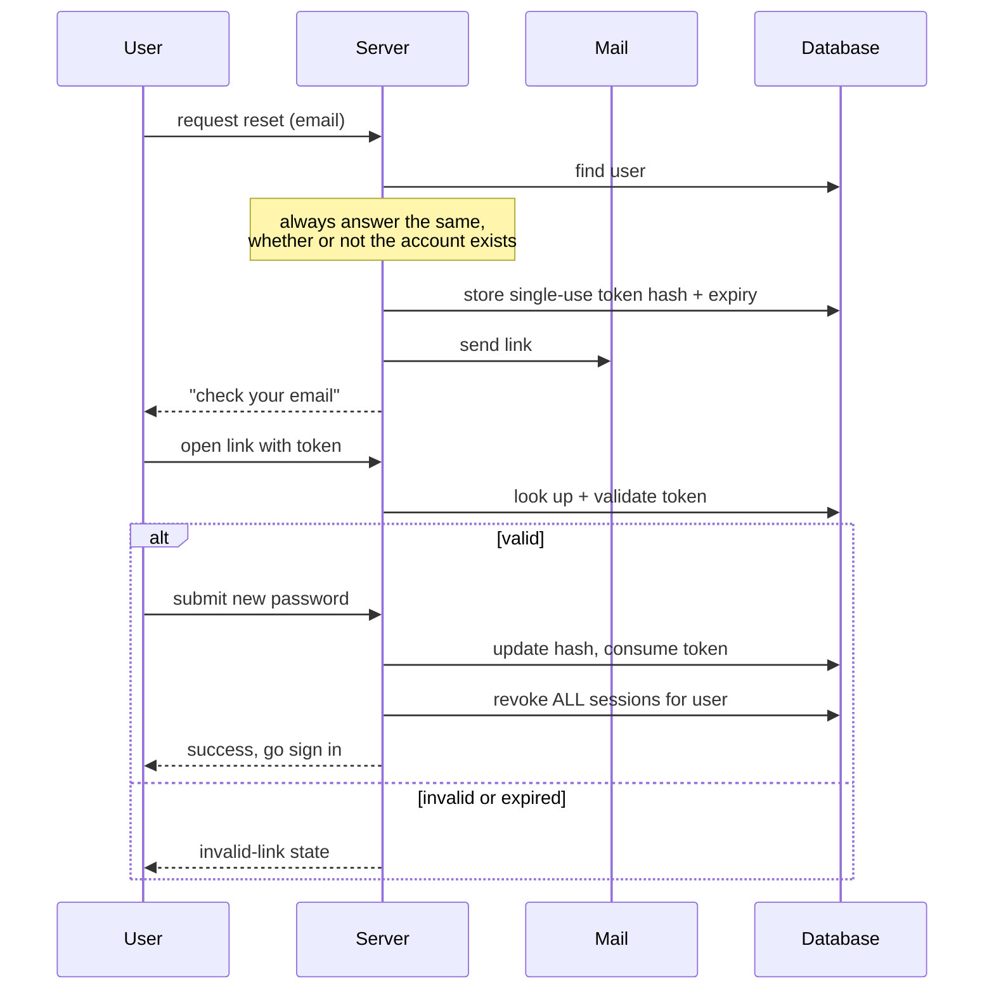

| Step | Item                                                       | Status |
| ---- | ---------------------------------------------------------- | ------ |
| 01   | Requirement — TTL (60 min), single use, session revocation | ⬜     |
| 04   | `password_reset_tokens` — hashed at rest, single-use       | ⬜     |
| 05   | Request-reset and submit-reset server actions              | ⬜     |
| 06   | Revoke every session on successful reset                   | ⬜     |
| 09   | Identical response whether or not the account exists       | ⬜     |
| 10   | Tests — expired, reused, cross-user token                  | ⬜     |

---

#### F. OAuth support — ⬜

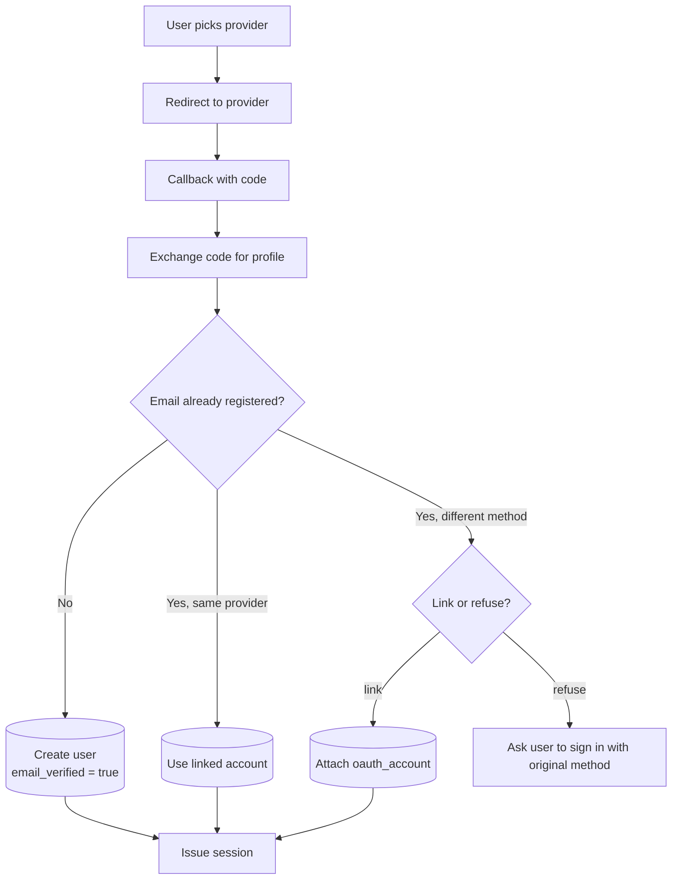

| Step | Item                                                           | Status |
| ---- | -------------------------------------------------------------- | ------ |
| 01   | Requirement — which providers, account-linking policy          | ⬜     |
| 04   | `oauth_accounts` — provider, provider_user_id, unique per pair | ⬜     |
| 05   | Authorize + callback route handlers, state/PKCE validation     | ⬜     |
| 06   | Link-vs-create decision, collision handling                    | ⬜     |
| 07   | Provider buttons on login and signup screens                   | ⬜     |
| 10   | Tests — new user, returning user, email collision              | ⬜     |

**Planned order:** email/password first, then OAuth, with **GitHub login later**
per [02-architecture.md](02-architecture.md) — GitHub matters most because the
MVP chain needs a GitHub connection anyway.

---

#### G. Access control — ⬜

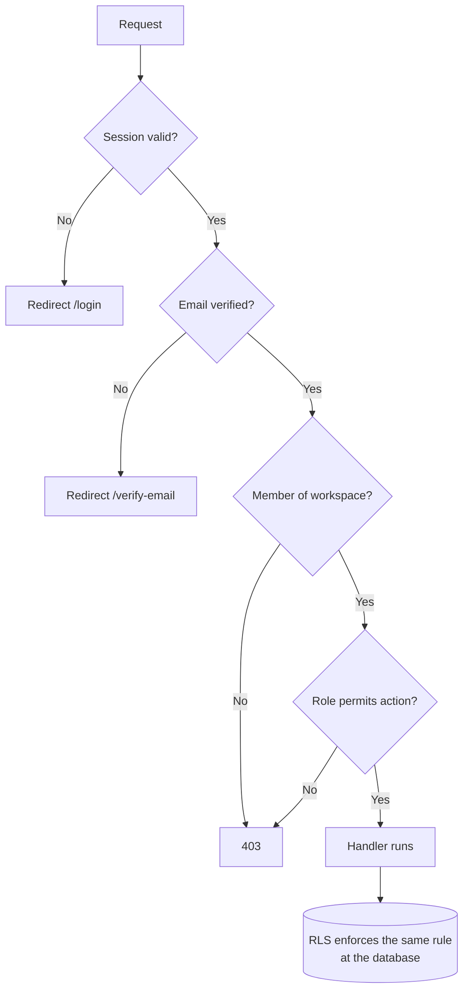

| Step | Item                                                             | Status |
| ---- | ---------------------------------------------------------------- | ------ |
| 01   | Requirement — roles, workspace vs project scope                  | ⬜     |
| 04   | Row Level Security policies mirroring the app rules              | ⬜     |
| 05   | Server-side guard for Server Components, actions, route handlers | ⬜     |
| 06   | Role checks: owner / admin / member                              | ⬜     |
| 07   | Wire the real session into `RequireAuth` / `RequireGuest`        | ⬜     |
| 10   | Tests — every deny path, not just the allow path                 | ⬜     |

**Rule:** the server is the only enforcement point. Client guards are display
logic. Every rule enforced in the app is enforced again in RLS.

---

### Gate for phase 0.1

Backend items B and S are done (2026-08-18, flag flipped 2026-08-19). The
remaining items D–G keep the phase gate open; the checks that hold locally:

- [x] `npm run typecheck`, `npm run lint`, `npm run test`, `npm run build` all exit 0 — 594 tests, verified 2026-08-19
- [x] A real user can sign up, log in, log out, and reset a password on the local stack (smoke-tested 2026-08-19); email verify runs on the local sender (B3)
- [x] `/dashboard`, `/projects`, `/settings` redirect a signed-out visitor — guards live with `AUTH_ENABLED`
- [x] Auth screens redirect an already-signed-in user
- [ ] `src/features/auth/lib/placeholder.ts` is deleted — unused since Task 7 but still present; tracked in blocker.md
- [x] Tests cover every deny path (auth actions, rate limit, lockout, CSRF)
- [x] This file and [06-status.md](06-status.md) updated

The phase as a whole stays open until D–G land (email sender choice B3,
unverified-user policy B4, OAuth provider choice B7).

---

## Blockers

| Blocker                                                    | Blocks             | Needed from   |
| ---------------------------------------------------------- | ------------------ | ------------- |
| ~~No Supabase project, URL, or anon key~~ — resolved locally 2026-08-18; cloud project still needed before deploy (see blocker.md) | deploy, real users | project owner |
| ~~Session strategy undecided~~ — resolved: Supabase-managed (D1)          | —                  | decision made  |
| Email delivery provider not chosen                         | D, E               | decision      |
| Unverified-user policy undecided                           | D, G               | decision      |

---

## 0.2 User profile — ⬜ specified, not started

Requested 2026-08-13. Not built; no work has begun.

| Area              | Covers                                                  |
| ----------------- | ------------------------------------------------------- |
| Identity          | Name, avatar, email, username                           |
| Developer profile | Developer level, preferred technologies                 |
| Settings          | Profile settings, notification settings, AI preferences |
| Connections       | Connected integrations                                  |
| Account lifecycle | Account deletion, account export                        |

**Depends on** the user model (0.1.2 A) — a profile has nothing to attach to
until users exist. **Blocked by** B1 (Supabase) for anything persisted; avatar
upload additionally needs Supabase Storage, and account export/deletion need
the full schema in place to be meaningful.

Scope, flow diagram, and per-item 18-step checklists get added here when this
phase is authorized, in the same shape as 0.1.

---

## 0.3 Workspace — 🟡 A/B/C/F/H persist; members and billing deferred

Specified 2026-08-13. A workspace is the container a user works inside;
projects live in one. Wave 1 of [03-database.md](03-database.md).

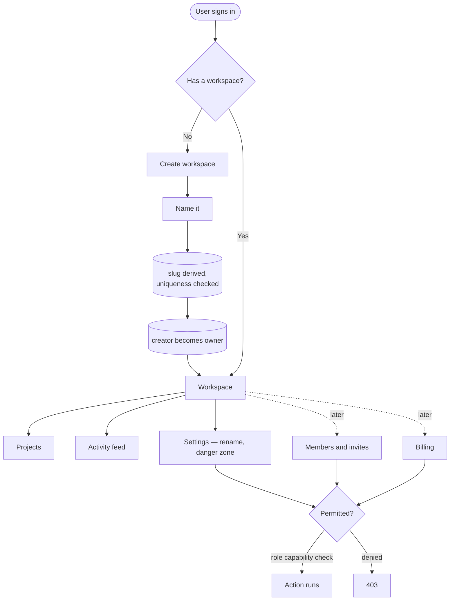

| #   | Item                  | Status | Notes                                                            |
| --- | --------------------- | ------ | ---------------------------------------------------------------- |
| A   | Workspace creation    | ✅     | Creation persists (Task 8): service + actions + `workspace_activities` |
| B   | Workspace name        | ✅     | Rename persists (Task 8), gated on `workspace:update`                   |
| C   | Workspace settings    | ✅     | Rename and delete persist through server actions (Task 8)               |
| D   | Workspace members     | ⬜     | **Deferred by the project owner — "later"**                      |
| E   | Workspace projects    | 🟡     | Projects persist (Task 9) but the list read path is not built — `/projects` still shows its empty state |
| F   | Workspace activities  | ✅     | Events recorded (Task 8); feed reads them back (final review round) — `loadWorkspaceActivityAction`, newest 50, integration-tested |
| G   | Workspace billing     | ⬜     | **Deferred by the project owner — "later"**                      |
| H   | Workspace permissions | 🟡     | Model tested; enforced in the workspace + project services (Tasks 8–9) and the codebase canvas save/load gates (final review round); RLS read-only so far |

**Roles.** `owner` → `admin` → `member` → `viewer`, each strictly containing
the next. Capability checks are pure functions so the same rule can run in a
server action and, later, in a Row Level Security policy.

**Blocked by** B1 (cloud project) for deploy and real users only — local
persistence landed 2026-08-18 (Task 8) and the actions now run through a real
`getSession()` since Task 11 flipped `AUTH_ENABLED` (2026-08-19).

### Delivered 2026-08-13

| Piece                                              | File                                   | Tests |
| -------------------------------------------------- | -------------------------------------- | ----- |
| Slug derivation, reserved words, uniqueness        | `lib/slug.ts`                          | 19    |
| Role/capability model                              | `lib/permissions.ts`                   | 16    |
| Name and slug validation, delete confirmation      | `lib/schemas.ts`                       | —     |
| Create workspace form, slug auto-derives from name | `components/create-workspace-form.tsx` | —     |
| Rename form                                        | `components/rename-workspace-form.tsx` | —     |
| Delete, gated on retyping the exact name           | `components/delete-workspace.tsx`      | —     |
| Activity feed with empty state                     | `components/activity-feed.tsx`         | —     |

Routes: `/workspaces/new`, `/settings/workspace`, `/activity`. Activity added to
the sidebar.

**Verified in Chrome:** all three pages render with zero console issues; the
slug derives `Café Ünïcode, Inc.` → `cafe-unicode-inc`; editing the slug stops
it following the name; a reserved slug is rejected; the delete button stays
disabled until the workspace name is retyped exactly.

**Not built:** members, invites, and billing are deferred by the project
owner. The feed read path landed 2026-08-19 (final review round): the activity
page resolves the user's workspace and the feed loads its events.

### Delivered 2026-08-18 (Task 8 — workspace persistence)

| Piece                                            | File                                          | Tests |
| ------------------------------------------------ | --------------------------------------------- | ----- |
| Service: create/rename/delete + permission gates | `server/workspace-service.ts`                 | 4     |
| Seam interface `WorkspaceDb`, result union       | `server/workspace-service.ts`                 | —     |
| Drizzle implementation (app glue)                | `src/lib/server/stores/workspace-store.ts`    | —     |
| Server actions `create/rename/deleteWorkspaceAction` | `lib/actions.ts`                           | —     |
| `workspace_activities` table + RLS (member read) | `database/schema.ts`, `0001_wave1_rls.sql`    | 1     |
| Forms wired to real actions                       | 3 workspace components + settings page        | —     |
| `"workspace.deleted"` added to `ActivityKind`     | `types.ts` (+ feed icon)                      | —     |

Gates green 2026-08-18: typecheck, lint (0 errors), 564 tests, production build.

### Fix round 2026-08-18 (Task 8 review)

- Deleted slugs stay reserved — `listWorkspaceSlugs` now reads every row, so
  delete-then-recreate suffixes (`acme` → `acme-2`) instead of crashing on the
  unique index (BUG-019).
- Delete confirmation is verified server-side against the workspace's real
  name via `findWorkspace` on the `WorkspaceDb` seam; wrong confirmation,
  missing workspace, and already-deleted workspace each return a clean error.
- Edited slugs are honored by `createWorkspace` — the requested slug wins, with
  uniqueness and reserved-word checks still applied.
- Rename has the same missing/already-deleted guards; all three actions wrap
  service calls in try/catch (`"Something went wrong. Try again."`) and
  `revalidatePath("/workspaces")` after rename and delete too.

Gates green 2026-08-18: typecheck, lint (0 errors), 570 tests, production build.

**Gate:** a signed-in user can create a workspace, rename it, see its projects
and activity, and a `viewer` is refused every mutating action — enforced on the
server and again in RLS.

---

## 0.4 Project creation — 🟡 wizard and settings persist; read path deferred

Specified 2026-08-13. A project is what devstep actually operates on — the
first two links of the [MVP chain](04-roadmap.md#the-mvp) are _create project_
and _import project_.

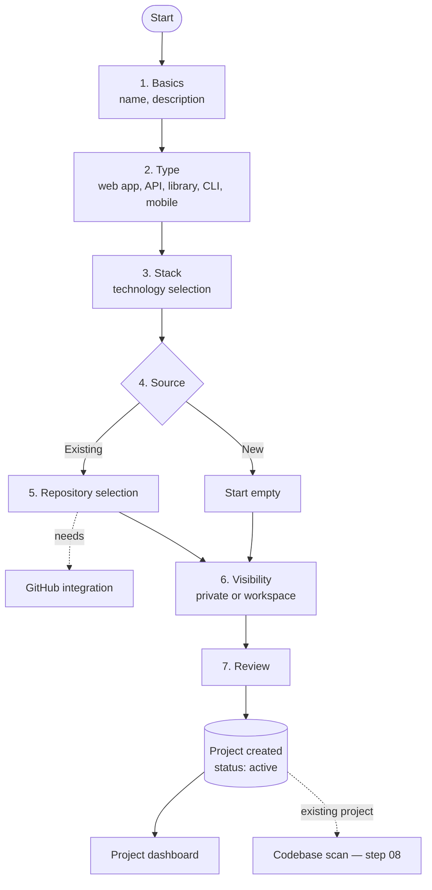

| #   | Item                    | Status | Notes                                                                  |
| --- | ----------------------- | ------ | ---------------------------------------------------------------------- |
| A   | Project name            | ✅     | Schema + validation; saved with the wizard (Task 9)                    |
| B   | Description             | ✅     | Optional, length-capped; saved with the wizard (Task 9)                |
| C   | Project type            | ✅     | Fixed catalogue; saved with the wizard (Task 9)                        |
| D   | Technology selection    | 🟡     | Catalogue + multi-select; detection is step 08–10; stack not persisted yet |
| E   | New vs existing project | 🟡     | Branches the wizard; source not persisted yet                          |
| F   | Repository selection    | ⬜     | **Needs the GitHub integration (step 15)**                             |
| G   | Project visibility      | ✅     | Private or workspace-visible; saved with the wizard (Task 9)           |
| H   | Project status          | ✅     | active · paused · archived; saved with the wizard (Task 9)             |
| I   | Creation wizard         | ✅     | Step machine built and tested; save persists (Task 9)                  |
| J   | Project settings        | ✅     | Form + page wired to real actions (Task 9); project resolution partial per page's empty state |

**Blocked by** B6/GitHub for repository selection; the projects-list read path
and route-level project selection are **remaining work** (planned for Task 11
but not in its final scope — see [blocker.md](blocker.md)).

### Delivered 2026-08-13

| Piece                                                           | File                                   | Tests |
| --------------------------------------------------------------- | -------------------------------------- | ----- |
| Wizard step machine — branching path, per-step rules            | `lib/wizard.ts`                        | 24    |
| Technology catalogue — 44 entries, search, aliases, suggestions | `lib/technologies.ts`                  | 18    |
| Name, description, settings validation                          | `lib/schemas.ts`                       | —     |
| Seven-step wizard UI                                            | `components/project-wizard.tsx`        | —     |
| Technology picker — search, categories, multi-select            | `components/technology-picker.tsx`     | —     |
| Project settings form                                           | `components/project-settings-form.tsx` | —     |

Routes: `/projects/new`, `/settings/project`. The projects list now has a real
empty state and a "New project" action.

**Verified in Chrome, both branches walked end to end**

- Empty name blocks with _"Give the project a name of at least 2 characters"_
- Choosing **AI app** pre-selects 4 suggested technologies
- New-project path: **Step 1 of 6**, repository step skipped
- Choosing "existing" re-plans the wizard live to **Step 4 of 7**
- Repository step blocks with _"Choose a repository to import"_ until filled
- Review lists all 8 fields; create reports storage is unavailable
- Zero console errors or warnings throughout

**Design note.** The stated stack (what the developer picks here) is kept
separate from the detected stack (build-order steps 09–10, read from the
codebase). A mismatch between the two is a signal worth surfacing, not an
inconsistency to hide.

**Not built:** the projects-list read path — the list still shows its empty
state, so a created project does not appear there (remaining work, see
blocker.md) — and repository _selection_ — the repository step accepts a
manually typed `owner/repo` because the GitHub integration does not exist yet.

### Delivered 2026-08-19 (Task 9 — project persistence)

| Piece                                                              | File                                          | Tests |
| ------------------------------------------------------------------ | --------------------------------------------- | ----- |
| Service: create/update/read + permission gates, soft-delete guards | `server/project-service.ts`                   | 6     |
| Seam interface `ProjectDb`, result union                           | `server/project-service.ts`                   | —     |
| Drizzle implementation (app glue) + `findCurrentProject`           | `src/lib/server/stores/project-store.ts`      | 1     |
| Server actions `create/updateProjectSettingsAction`                | `lib/actions.ts`                              | —     |
| `findWorkspacesForUser` (wizard workspace resolution)              | `src/lib/server/stores/workspace-store.ts`    | —     |
| Wizard final step saves; success state links to /projects          | `components/project-wizard.tsx`, `/projects/new` | —   |
| Settings form wired to real action (error + success banners)       | `components/project-settings-form.tsx`        | —     |
| Settings page loads real data or an honest empty state             | `src/app/settings/project/page.tsx`           | —     |

The slug-reservation integration test is the same discriminator as BUG-019's
(soft-deleted slugs stay reserved because the unique index covers deleted
rows): it fails against a store that filters `isNull(projects.deletedAt)` and
passes against the real one — proven both ways before landing.

Gates green 2026-08-19: typecheck, lint (0 errors), 578 tests, production build.

### Fix round 2026-08-19 (Task 11)

- `createProject` now guards the workspace itself, not just the membership
  row: a workspace that does not exist → "Workspace not found.", a
  soft-deleted workspace → "Workspace already deleted." (a membership row
  survives a soft delete, so membership alone was not enough). `ProjectDb`
  gained `findWorkspace`; 2 service tests added — 8 in this file, 594 in the
  final gate run.

**Gate:** a signed-in user completes the wizard, the project appears in their
workspace with the chosen type, stack, visibility, and status, and settings can
change each afterwards. The appearance in the workspace list still waits on the
read path (blocker.md).

---

## 0.5 Project dashboard — 🟡 logic and panels done, data deferred

Specified 2026-08-13. The screen that answers the product's three questions at
a glance: _what is happening, what should I do next, how do I do it._

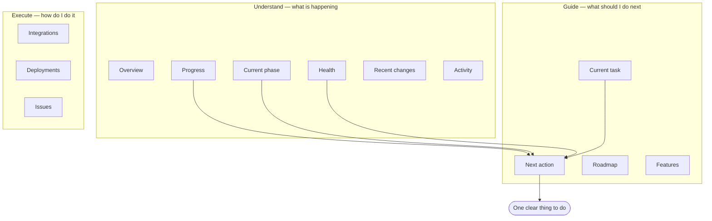

| #   | Item             | Status | Notes                                      |
| --- | ---------------- | ------ | ------------------------------------------ |
| A   | Project overview | 🟡     | Header: name, type, stack, status          |
| B   | Progress         | 🟡     | Computed from phases and tasks             |
| C   | Current phase    | 🟡     | Derived, not stored                        |
| D   | Current task     | 🟡     | First incomplete task in the current phase |
| E   | Next action      | 🟡     | Single highest-priority thing to do        |
| F   | Health           | 🟡     | Composite score from signals               |
| G   | Roadmap          | 🟡     | Phase list with progress                   |
| H   | Features         | 🟡     | Summary counts                             |
| I   | Integrations     | 🟡     | Connection status per service              |
| J   | Deployments      | 🟡     | Latest deployment and environment          |
| K   | Activity         | 🟡     | Reuses the workspace activity feed         |
| L   | Issues           | 🟡     | Open problems needing attention            |
| M   | Recent changes   | 🟡     | Latest commits                             |

**The point of the dashboard.** Not a wall of widgets — a ranked answer. Every
panel feeds the _next action_, which is the one thing a new developer should do
now. If a panel does not help answer that, it does not belong.

**Blocked by** B1 for every real number. Panels render their true empty state
until data exists.

**Storage (Task 3).** Wave 1 schema landed: `users`, `workspaces`,
`workspace_members`, `projects`, `project_members`, `project_integrations` in
`src/features/database/schema.ts`. `npm run db:setup` applies the Drizzle
migrations then the RLS policies; `npm run db:tables` lists the six tables.
Panels still render empty states — nothing writes yet.

### Delivered 2026-08-13

| Piece                                               | File                               | Tests |
| --------------------------------------------------- | ---------------------------------- | ----- |
| Progress, current phase, current task — all derived | `lib/progress.ts`                  | 14    |
| Health scoring with ranked reasons                  | `lib/health.ts`                    | 10    |
| Next-action ranking                                 | `lib/next-action.ts`               | 11    |
| Panel shell with honest empty states                | `components/dashboard-panel.tsx`   | —     |
| Next-action hero card                               | `components/next-action-card.tsx`  | —     |
| Health card                                         | `components/health-card.tsx`       | —     |
| Composed dashboard, all 13 panels                   | `components/project-dashboard.tsx` | —     |

**Verified in Chrome.** All 13 panels render at `/dashboard` with zero console
issues. With no project connected the next action correctly reads **"Connect a
repository"** — because that is genuinely what such a project needs.

**Decisions worth keeping**

- **Nothing is stored.** Current phase and current task are _derived_ from what
  is finished, so they cannot drift out of sync the way a stored pointer would.
- **An empty phase reports 0%, not 100%.** Unplanned is not finished.
- **Progress never shows 100% while a task is open** — it caps at 99.
- **No tests scores worse than failing tests.** Failing tests tell you
  something; no tests tell you nothing.
- **Health is never a bare number.** Every deduction carries a label and a
  weight, sorted worst-first, so the score becomes a to-do list.
- **Panels say "nothing known yet" rather than inventing numbers.** Health shows
  no score at all without signals.

**Gate:** a developer opens a project and can say, without reading
documentation, what state it is in and what to do next.

---

# Phase 1 — Project Import & Codebase Intelligence

**Make the platform understand real projects.**

Phase 0 built the platform. Phase 1 is where it stops being a shell: devstep
reads actual code and forms an opinion about it. Every later phase — roadmap,
guidance, health — is only as good as what this phase understands.

## 1.1 Local project import — ✅ scans saved, index persists

Specified 2026-08-13.

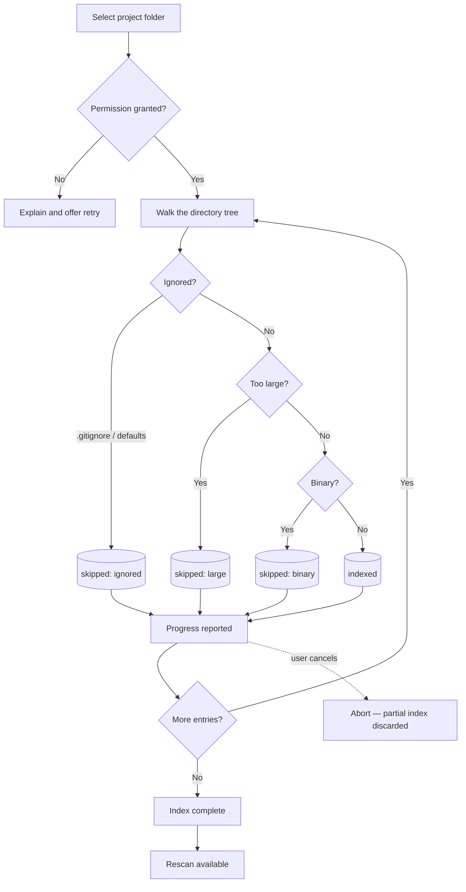

| #   | Item                  | Status | Notes                                                        |
| --- | --------------------- | ------ | ------------------------------------------------------------ |
| A   | Select project folder | ✅     | File System Access API, with a directory-input fallback      |
| B   | Folder permission     | ✅     | Permission states handled and explained                      |
| C   | File indexing         | ✅     | Index built from walked entries                              |
| D   | Ignore files          | ✅     | Sensible defaults — `node_modules`, `.next`, build output    |
| E   | `.gitignore` support  | ✅     | Pattern engine: negation, anchoring, globs, directory-only   |
| F   | Large-file handling   | ✅     | Threshold, skipped with a reason                             |
| G   | Binary-file detection | ✅     | Extension list plus a content heuristic                      |
| H   | Scan progress         | ✅     | Reported per entry                                           |
| I   | Scan cancellation     | ✅     | `AbortSignal`, partial index discarded                       |
| J   | Errors                | ✅     | Collected per file; one unreadable file never fails the scan |
| K   | Rescan                | ✅     | Re-runs against the same handle; a rescan saves a new snapshot (Task 10) |

**Browser reality.** Reading a local folder needs the File System Access API,
which is Chromium-only and requires an explicit user gesture and permission
grant. Firefox and Safari fall back to a directory `<input>`, which copies file
contents into the page rather than granting live access — so **rescan is
unavailable on that path**. Deep, repeated local analysis is what the eventual
desktop app is for; this is the honest limit of the web version.

**Privacy.** File contents are read in the browser to build an index. Nothing
is uploaded — consistent with the rule in
[02-architecture.md](02-architecture.md) that a source repository is never
copied to the cloud.

**Gate:** a developer picks a real project folder and sees an accurate index —
`node_modules` excluded, `.gitignore` honoured, binaries and large files
skipped with reasons, progress visible throughout, and cancellation that leaves
nothing behind — and saves it so the scan persists in the database. ✅ — the
scan saves (Task 10) and the import screen loads it back on mount (final
review round): a "Saved scan from <date> — N file(s) indexed." line appears
above the picker. The rescan-diff against the saved snapshot is still
remaining work (see [blocker.md](blocker.md)).

### Delivered 2026-08-13

| Piece                                                            | File                            | Tests |
| ---------------------------------------------------------------- | ------------------------------- | ----- |
| `.gitignore` engine — negation, anchoring, globs, directory-only | `lib/ignore.ts`                 | 23    |
| Binary and large-file classification                             | `lib/classify.ts`               | 16    |
| Scanner — progress, cancellation, error tolerance                | `lib/scan.ts`                   | 11    |
| Browser adapters — handle and directory-input                    | `lib/browser-source.ts`         | —     |
| Import UI — picker, permission, progress, cancel, rescan, errors | `components/import-project.tsx` | —     |

Route: `/projects/import`.

**Verified against a real folder on disk**, driven through the browser:

| Bucket    | Count | Files                                                                                    |
| --------- | ----- | ---------------------------------------------------------------------------------------- |
| Indexed   | 4     | `src/index.ts`, `src/util.ts`, `README.md`, `.gitignore`                                 |
| Ignored   | 3     | `secrets/key.txt`, `scratch.tmp` (`.gitignore`), `node_modules/react/index.js` (default) |
| Binary    | 1     | `assets/logo.png`                                                                        |
| Too large | 1     | `data/big.json`, 1.2 MB                                                                  |

Nine files in, nine accounted for, zero console issues.

**Design decisions**

- **The filesystem is injected**, not imported. The same scanner runs against a
  live directory handle, a directory-input snapshot, and a fake tree in tests.
- **One unreadable file never fails a scan.** Errors are collected per file and
  reported alongside the index — a permission problem in one directory does not
  make the project unknowable.
- **A cancelled scan is discarded, not shown.** A partial index misrepresents a
  project, so cancelling returns to the starting state.
- **Progress is indeterminate on purpose.** The total entry count is unknown
  until the walk finishes; a percentage would be invented.
- **Size is checked before content**, so a huge video reports "too large"
  rather than "binary" — the more useful thing to tell someone.
- **Lockfiles are indexed, not ignored.** They identify the package manager.

### Delivered 2026-08-19 (Task 10 — canvas persistence)

| Piece                                                        | File                                              | Tests |
| ------------------------------------------------------------ | ------------------------------------------------- | ----- |
| Service: save/load seam with project existence + soft-delete guards | `server/codebase-service.ts`                | 6     |
| Drizzle implementation (app glue) + `codebaseService`        | `src/lib/server/stores/codebase-store.ts`         | 3     |
| Server actions `saveImportAction` / `loadLatestImportAction` | `lib/actions.ts`                                  | —     |
| Import screen saves the scan; "Index saved." state line      | `components/import-project.tsx`                   | —     |
| Import page resolves the current project or an empty state   | `src/app/projects/import/page.tsx`                | —     |
| Import screen loads the saved scan on mount; permission gates on save/load (final review round) | `components/import-project.tsx`, `server/codebase-service.ts` | +5  |

A save writes one `codebase_scans` row (entries, skipped, errors, analysis —
plain JSONB) and replaces the codebase's `detected_technologies` /
`detected_features` rows. The discriminating integration test proves
`findLatestScan` returns the newest scan of the project's own codebase — it
failed against an ascending-order store and passed against the real one,
proven both ways. Detection confidence (0..1 in the engine) is stored as a
0..100 integer — the raw float would silently round to 1 in the integer column
(BUG-020).

Gates green 2026-08-19: typecheck, lint (0 errors), 592 tests, production build.

### For the desktop app — ⬜ all deferred

Specified 2026-08-13, every item marked **later** by the project owner. None of
these are buildable in a browser; they are the reason a desktop app exists at
all.

| Item                  | Why it needs the desktop app                  |
| --------------------- | --------------------------------------------- |
| macOS folder access   | Native permission model; no per-visit grant   |
| Windows folder access | Same, on a different permission model         |
| Local project watcher | Browsers cannot watch a directory for changes |
| Real-time changes     | Requires a persistent watcher process         |
| Background scanning   | Requires running with no page open            |

The Tauri-vs-Electron decision is still open — see
[02-architecture.md](02-architecture.md). Until then the web version's limits
stand: a permission grant per visit on Chromium, and no rescan at all on the
directory-input fallback.

---

---

## 1.2 GitHub import — 🟡 logic built, needs an OAuth App to run

Specified 2026-08-13. The MVP chain's _connect GitHub_ link, and the second way
a project gets into devstep.

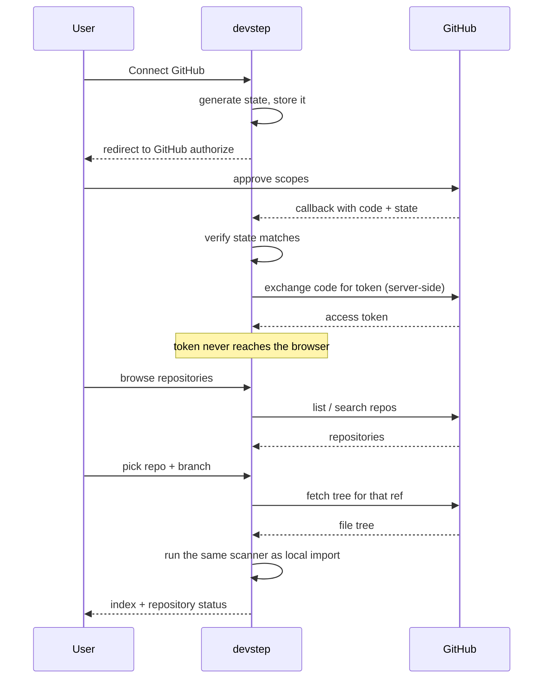

| #   | Item                 | Status | Notes                                                                                                     |
| --- | -------------------- | ------ | --------------------------------------------------------------------------------------------------------- |
| A   | GitHub OAuth         | 🟡     | Authorize URL, state generation and verification, callback parsing — all built; needs an OAuth App to run |
| B   | Repository list      | 🟡     | Paginated, sorted by recent activity                                                                      |
| C   | Repository search    | 🟡     | Client-side filter plus the search endpoint                                                               |
| D   | Repository selection | 🟡     | UI built                                                                                                  |
| E   | Branch selection     | 🟡     | Lists branches, defaults to the repo's default                                                            |
| F   | Repository metadata  | 🟡     | Language, size, visibility, stars, last push                                                              |
| G   | Clone / access       | 🟡     | **No clone.** Reads the tree over the API — nothing is copied to a server                                 |
| H   | Initial scan         | 🟡     | Reuses the phase 1.1 scanner unchanged                                                                    |
| I   | Rescan               | 🟡     | Re-fetches the tree for the same ref                                                                      |
| J   | Repository status    | 🟡     | Connection, permissions, and rate-limit state                                                             |

**Why there is no clone.** Cloning would copy a source repository onto a
server, which [02-architecture.md](02-architecture.md) forbids. The Git Trees
API returns the whole file list in one request, and blobs are fetched only for
files the scanner decides to index.

**The scanner is not rewritten.** `ScanSource` was injected in 1.1 precisely so
a second backend could satisfy it. GitHub becomes a third implementation
alongside the directory handle and the directory-input snapshot.

**Security.** The access token is exchanged and held server-side and never
reaches the browser. The OAuth `state` parameter is generated, stored, and
verified on return — without it the callback is an open door for CSRF.

**Blocked by** a registered GitHub OAuth App (client ID and secret), a server
session to hold the token (0.1.2 B), and B1 for storing the connection.

### Delivered 2026-08-13

| Piece                                              | File                               | Tests |
| -------------------------------------------------- | ---------------------------------- | ----- |
| OAuth — authorize URL, state, callback validation  | `lib/oauth.ts`                     | 17    |
| REST client — repos, search, branches, tree, blobs | `lib/client.ts`                    | 15    |
| `ScanSource` over the GitHub API                   | `lib/github-source.ts`             | 7     |
| Connection card with honest states                 | `components/github-connect.tsx`    | —     |
| Repository list, search, selection, branch picker  | `components/repository-picker.tsx` | —     |

Route: `/projects/import/github`.

**The scanner was not touched.** `createGitHubSource` satisfies the same
`ScanSource` interface as the local adapters, so `scanProject` walks a remote
repository with identical ignore rules, binary and size handling, progress, and
cancellation. Tests prove a remote scan produces the same buckets as a local
one — and that ignored, binary, and oversized files are **never downloaded**,
because the scanner decides before a blob is fetched.

**Security decisions**

- **Scopes are `read:user` and `public_repo`.** A test asserts `repo` is never
  requested — it would grant write access to every private repository, which an
  importer has no business holding.
- **`state` is generated, stored, and compared in constant time.** Without it,
  an attacker can hand a victim's browser their own `code` and silently link
  the victim's devstep account to the attacker's GitHub.
- **The token never reaches the browser** and never appears in an error
  message — a test asserts the token is absent from thrown errors.
- **Nothing is cloned.** One Trees API call returns the file list; blobs are
  fetched only for files being indexed.
- **Search filters the accessible list** rather than calling GitHub's search
  endpoint, which has a stricter rate limit and cannot see every private
  repository the user can already list.

**Verified in Chrome.** The page reports GitHub as unavailable and explains
why, rather than offering a Connect button that would go nowhere. Zero console
issues.

**Not built:** token exchange (needs a client secret), storing the connection,
and rescan against a stored ref.

**Gate:** a developer connects GitHub, picks a repository and branch, and gets
the same accurate index they would get from importing that project locally.

---

## 1.3 Codebase scanner

### 1.3.1 Inspect — ✅ delivered

Specified 2026-08-13. The scanner in 1.1 answers _which files exist_. This
answers _what they are_ — turning a flat index into a structural picture.

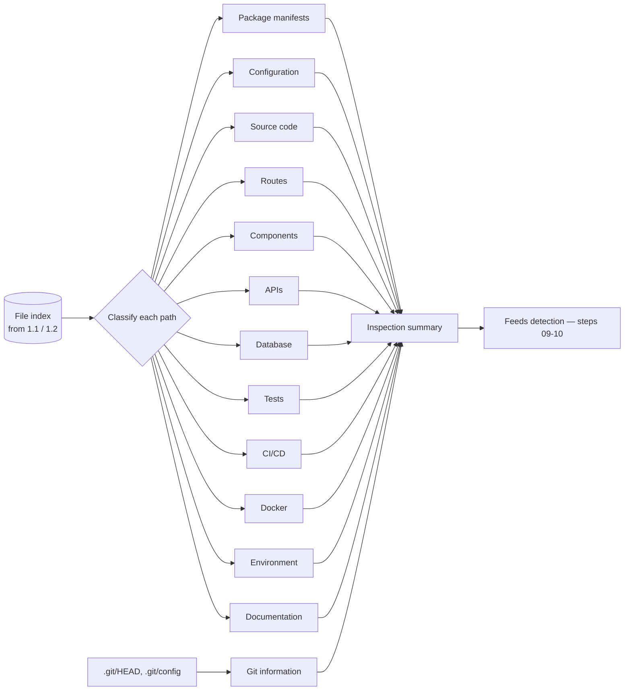

| #   | Item              | Status | Notes                                                 |
| --- | ----------------- | ------ | ----------------------------------------------------- |
| A   | Files             | 🟡     | Counts, sizes, extensions                             |
| B   | Folders           | 🟡     | Top-level structure                                   |
| C   | Configurations    | 🟡     | tsconfig, eslint, prettier, tailwind, and friends     |
| D   | Package files     | 🟡     | Manifests and lockfiles, per ecosystem                |
| E   | Source code       | 🟡     | Everything not otherwise classified                   |
| F   | Routes            | 🟡     | Next App/Pages Router, and common conventions         |
| G   | Components        | 🟡     | By directory convention and extension                 |
| H   | APIs              | 🟡     | Route handlers, API directories                       |
| I   | Database files    | 🟡     | Migrations, schemas, ORM config                       |
| J   | Tests             | 🟡     | By filename convention and test directories           |
| K   | CI/CD files       | 🟡     | GitHub Actions, GitLab CI, CircleCI                   |
| L   | Docker files      | 🟡     | Dockerfile, compose, .dockerignore                    |
| M   | Environment files | 🟡     | `.env*` — **flagged, never read**                     |
| N   | Documentation     | 🟡     | Markdown and docs directories                         |
| O   | Git information   | 🟡     | Branch and remotes from `.git/HEAD` and `.git/config` |

**Environment files are named, never opened.** `.env` is where secrets live.
Inspection records that one exists — which is useful, since a missing
`.env.example` is worth flagging — and never reads a byte of it.

**This is classification, not detection.** Working out _which framework_ a
project uses is build-order steps 09–10. This phase only says "these paths look
like routes"; nothing here guesses at Next.js versus Remix.

**Not blocked.** Pure functions over an index, so it runs today against a real
local import.

### Delivered 2026-08-13

| Piece                               | File                                | Tests |
| ----------------------------------- | ----------------------------------- | ----- |
| Role classification for every path  | `lib/inspect.ts`                    | 30    |
| Git branch and remotes from `.git/` | `lib/git-info.ts`                   | 14    |
| Structural summary panel            | `components/inspection-summary.tsx` | —     |

Wired into the import flow, so a real scan now ends with a structural picture.

**Verified against a real project folder in Chrome.** A twelve-file project
classified one file into each of the twelve roles — package, config, env,
CI/CD, Docker, tests, database, docs, API, route, component, source — read
`feature/import` and `octocat/demo` from `.git/`, and raised the missing
`.env.example` observation. Zero console issues.

**`.git/` is ignored by the walker but read directly.** Its object files would
swamp an index, so `readGitInfo` opens `HEAD` and `config` by name instead.

**Observations, not just counts.** No tests, no CI, no docs, and a `.env`
without a committed example are each called out — a count of zero tests is only
useful if someone says why that matters.

**Gate:** importing a real project produces a structural summary a developer
recognises as their own project.

---

### 1.3.2 Scanner engine — 🟡 detection works, AST deferred

Specified 2026-08-13. Inspect says what each file _is_; the engine works out
what the project _does_.

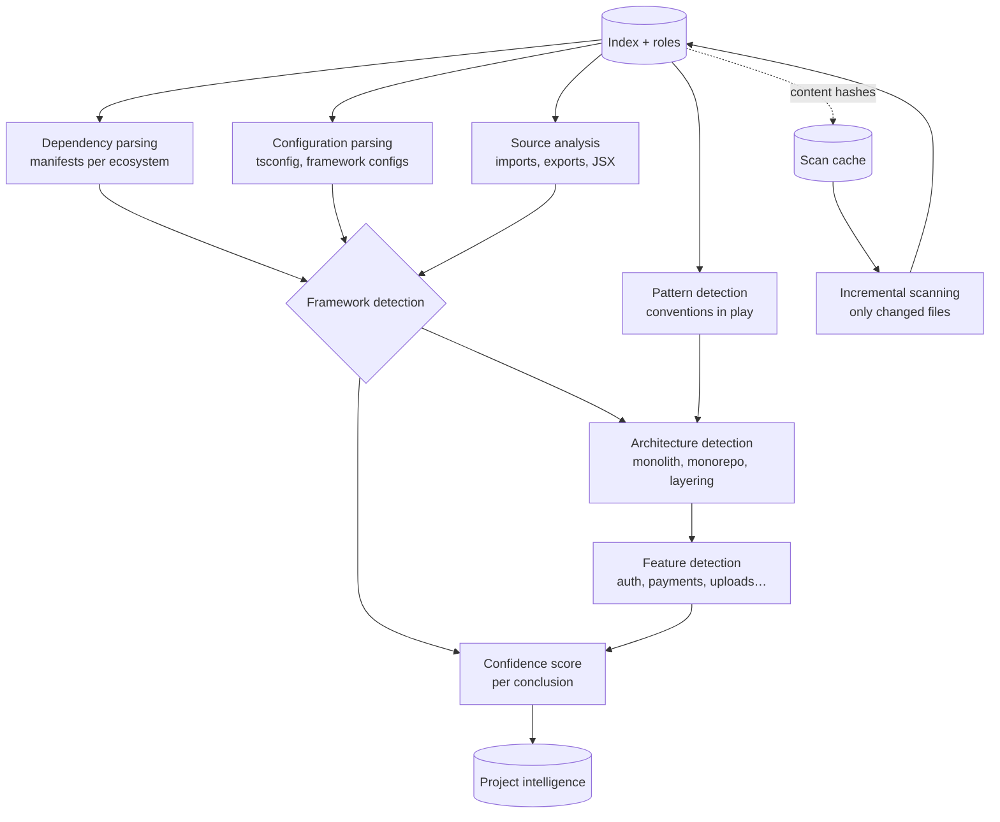

| #   | Item                   | Status | Notes                                                      |
| --- | ---------------------- | ------ | ---------------------------------------------------------- |
| A   | File indexing          | ✅     | Delivered in 1.1                                           |
| B   | AST parsing            | ⬜     | See the note below — a real parser is a heavy dependency   |
| C   | Dependency parsing     | ⬜     | `package.json`, `requirements.txt`, `go.mod`, `Cargo.toml` |
| D   | Configuration parsing  | ⬜     | `tsconfig`, framework configs                              |
| E   | Pattern detection      | ⬜     | Conventions actually in use                                |
| F   | Framework detection    | ⬜     | From dependencies, configs, and file layout together       |
| G   | Architecture detection | ⬜     | Monorepo vs single app, layering                           |
| H   | Feature detection      | ⬜     | Auth, payments, uploads, realtime                          |
| I   | Confidence score       | ⬜     | Every conclusion carries one                               |
| J   | Scan cache             | ⬜     | Keyed by content hash                                      |
| K   | Incremental scanning   | ⬜     | Rescan only what changed                                   |

**On AST parsing.** A real parser in the browser is a multi-megabyte
dependency, and this scan runs client-side. The plan is lightweight source
analysis first — imports, exports, and JSX usage, which is what framework and
feature detection actually need — with full AST deferred until there is a
reason to pay for it. That decision is recorded rather than assumed.

**Every conclusion carries a confidence score.** "This is a Next.js project"
inferred from a dependency plus an `app/` directory plus a `next.config.ts` is
worth more than the same claim from one signal. A new developer being told
something wrong with certainty is worse than being told it is a guess.

### Delivered 2026-08-13

| Piece                                          | File                               | Tests |
| ---------------------------------------------- | ---------------------------------- | ----- |
| Manifest parsing across four ecosystems        | `lib/dependencies.ts`              | 17    |
| Framework, architecture, and feature detection | `lib/detect.ts`                    | 21    |
| Fingerprinting, diffing, scan cache            | `lib/cache.ts`                     | 15    |
| Analysis pipeline over a completed scan        | `lib/analyze.ts`                   | —     |
| Detection panel with evidence                  | `components/detection-summary.tsx` | —     |

**Verified by scanning this project with itself.** devstep was pointed at a
copy of its own source and reported:

| Conclusion                        | Confidence | Evidence                                         |
| --------------------------------- | ---------- | ------------------------------------------------ |
| Next.js                           | certain    | `next` 16.3.0, `next.config.ts`, matching layout |
| Single application, feature-first | likely     | one manifest, code grouped by feature            |
| Authentication                    | likely     | `@node-rs/argon2`, 35 matching paths             |

All three are correct. React was correctly _suppressed_ — Next.js already
implies it, so reporting both would be noise. Zero console issues.

**Confidence is computed, not asserted.** Signals combine with diminishing
returns (`1 − ∏(1 − weight)`), so three independent signals reach "certain"
while any single one — however strong — cannot. Evidence is shown beside every
conclusion, so a developer who disagrees can see exactly which signal produced
it rather than being told to trust a label.

**On AST parsing.** Still deferred, deliberately. Detection reached "certain"
on this project from manifests, config files, and directory layout alone — none
of which need a parser. A multi-megabyte parser in the browser should wait
until something actually fails without it.

**Fingerprinting uses FNV-1a, not a cryptographic hash.** The question is "did
this change since we last looked", where a collision costs one unnecessary
re-read. A crypto bundle would be paid for on every page load to answer a
question that does not need it.

**Gate:** importing a real project reports its framework, architecture, and
notable features, each with a confidence score, and a rescan of an unchanged
project completes without re-reading every file.

---

## 1.4 Language detection — ✅ delivered

Specified 2026-08-13.

### Detect

TypeScript · JavaScript · Python · Java · PHP · Go · Rust · C# · C++ · C ·
Ruby · Kotlin · Swift · Dart · HTML · CSS · SQL · Shell — and anything else
recognised, with everything unknown grouped rather than dropped.

### Show

A language breakdown with percentages.

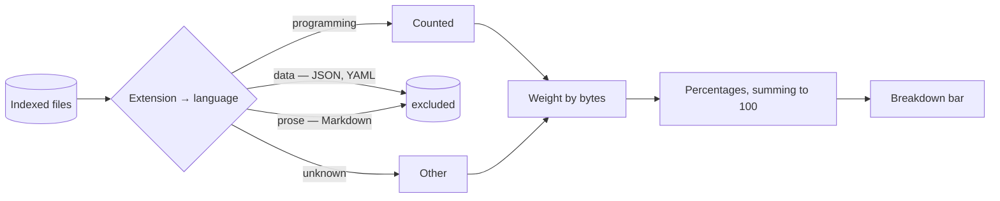

| #   | Item                     | Status | Notes                                                            |
| --- | ------------------------ | ------ | ---------------------------------------------------------------- |
| A   | Language mapping         | 🟡     | Extension to language, with ambiguity handled                    |
| B   | Data and prose exclusion | 🟡     | JSON, YAML, Markdown are not languages a project is "written in" |
| C   | Byte weighting           | 🟡     | A 5,000-line file counts for more than a 3-line one              |
| D   | Percentages              | 🟡     | Must sum to exactly 100                                          |
| E   | Breakdown display        | 🟡     | Bar plus per-language figures                                    |

**Weighted by bytes, not file count.** Counting files would report a project
with fifty tiny config shims and three large source files as mostly config.
GitHub weights by bytes for the same reason.

**Data and prose are excluded from the denominator.** A repository is not "40%
JSON" because its lockfile is large. They are still counted and shown
separately — just not as languages the project is written in.

**Percentages sum to exactly 100.** Naive rounding produces 99 or 101, which
looks broken. Largest-remainder allocation is used instead.

**Not blocked.** Pure functions over the existing index.

### Delivered 2026-08-13

`lib/languages.ts` — **41 tests**. `components/language-breakdown.tsx`, wired
into the import flow through `analyzeProject`.

Every language you listed is covered — TypeScript, JavaScript, Python, Java,
PHP, Go, Rust, C#, C++, C, Ruby, Kotlin, Swift, Dart, HTML, CSS, SQL, Shell —
plus Vue, Svelte, Astro, Sass, Scala, Elixir, Lua, R, Perl, Haskell, Zig,
Objective-C, PowerShell, and Prisma. Unknown extensions group under **Other**
rather than vanishing.

**Verified by scanning this project.** Reported _TypeScript 96%, CSS 1%, Other
1%, Shell 1%, JavaScript 1%_ — summing to exactly 100, with bar widths matching
the figures, over 596 KB of source. Zero console issues.

**Decisions**

- **Weighted by bytes.** Counting files would report a project with fifty tiny
  config shims and three large source files as mostly config.
- **Data and prose excluded from the denominator**, but still counted and
  reported. A repository is not "40% JSON" because its lockfile is large.
- **Largest-remainder allocation** so percentages sum to exactly 100 — naive
  rounding gives 99 or 101, and the bar visibly under- or overflows. Tested
  against awkward cases like seven equal shares.
- **Every present language gets at least 1%**, so a real file never shows as 0.
- **A bare `.h` is attributed to C, not C++.** It could be either; guessing C++
  would misreport every C project that ships headers.

**Gate:** a real project reports a breakdown its author recognises, with
percentages that add up. ✅

---

## 1.5 Framework detection — ✅ delivered

Specified 2026-08-13. Broadens 1.3.2's detection into a first-class result:
which framework, at what version, on what evidence.

### Detect

Next.js · React · Vue · Nuxt · Angular · Svelte · SvelteKit · Express · NestJS ·
FastAPI · Django · Flask · Laravel · Rails · Spring · Flutter · React Native ·
Electron · Tauri

### Show

Framework · version · evidence · configuration · confidence

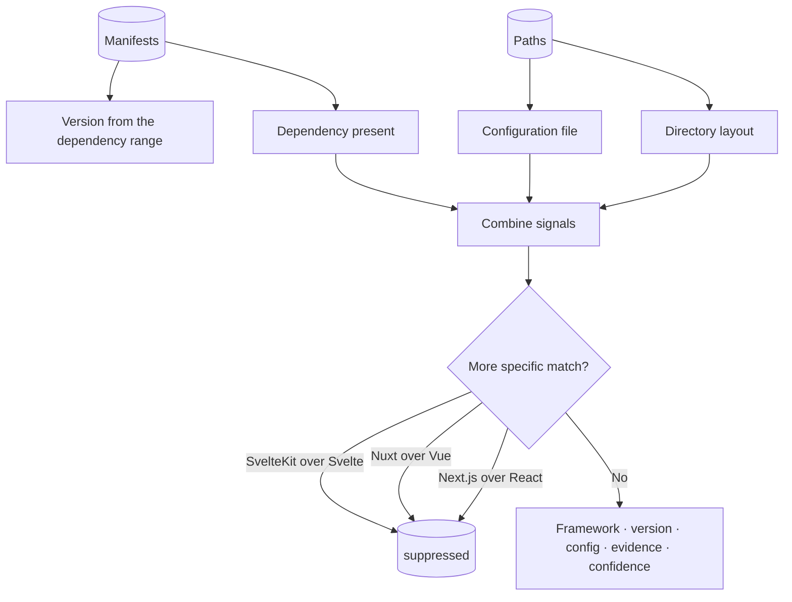

| #   | Item                      | Status | Notes                                                 |
| --- | ------------------------- | ------ | ----------------------------------------------------- |
| A   | 19 frameworks             | 🟡     | Across Node, Python, PHP, Ruby, Java, Dart, Rust      |
| B   | Version                   | 🟡     | From the declared dependency range                    |
| C   | Evidence                  | 🟡     | Already delivered in 1.3.2; extended                  |
| D   | Configuration             | 🟡     | The specific config file found                        |
| E   | Confidence                | 🟡     | Already delivered in 1.3.2                            |
| F   | Meta-framework precedence | 🟡     | SvelteKit over Svelte, Nuxt over Vue, Next over React |

**Meta-frameworks suppress what they build on.** A SvelteKit project is not
"SvelteKit and Svelte" — reporting both is noise, and a beginner reading the
list cannot tell which one matters. The more specific match wins and the base
is dropped.

**Version comes from the declared range, not the lockfile.** `^16.3.0` is what
the project asked for; the installed version lives in a lockfile that may not
be present. The range is reported as written rather than resolved to something
that might be wrong.

**Not blocked.** Extends existing pure functions.

### Delivered 2026-08-13

| Piece                                                                 | File                               | Tests |
| --------------------------------------------------------------------- | ---------------------------------- | ----- |
| 19 framework rules with version and config capture                    | `lib/detect.ts`                    | 29    |
| Four more manifest formats — composer, Gemfile, pubspec, Maven/Gradle | `lib/dependencies.ts`              | 6     |
| Version and config shown on the detection card                        | `components/detection-summary.tsx` | —     |

All nineteen are covered: Next.js, React, Vue, Nuxt, Angular, Svelte,
SvelteKit, Express, NestJS, FastAPI, Django, Flask, Laravel, Rails, Spring,
Flutter, React Native, Electron, Tauri — plus Fastify.

**Verified by scanning this project.** One card reported everything asked for:

> **Next.js · 16.3.0 · certain · next.config.ts**
> · `next` 16.3.0 in dependencies
> · configuration file `next.config.ts`
> · matching directory layout

React was suppressed, correctly. Zero console issues.

**Manifest coverage grew to eight formats** so the non-Node frameworks are
detectable at all: `composer.json` for Laravel, `Gemfile` for Rails,
`pubspec.yaml` for Flutter, and `pom.xml` / `build.gradle` for Spring, on top
of `package.json`, `requirements.txt`, `go.mod`, and `Cargo.toml`.

**Decisions**

- **Meta-frameworks suppress their base.** A SvelteKit project is not
  "SvelteKit and Svelte"; a beginner reading both cannot tell which one they
  are working in. Next.js and React Native both suppress React.
- **Version is the declared range, reported verbatim.** `^16.3.0` is what the
  project asked for; the installed version lives in a lockfile that may not be
  present. Reporting a guess as fact is worse than reporting the range.
- **Tauri is detectable with no dependency at all** — `src-tauri/tauri.conf.json`
  is enough, because the Rust side carries the dependency, not `package.json`.

**Gate:** a real project reports its framework with a version and the config
file that proves it. ✅

---

## 1.6 Runtime detection — ✅ delivered

Specified 2026-08-14.

### Runtimes

Node.js · Bun · Deno · Python · Java · PHP · Go · Rust · .NET

### Also detect

Version · package manager · runtime configuration · lock file · build command ·
development command · production command

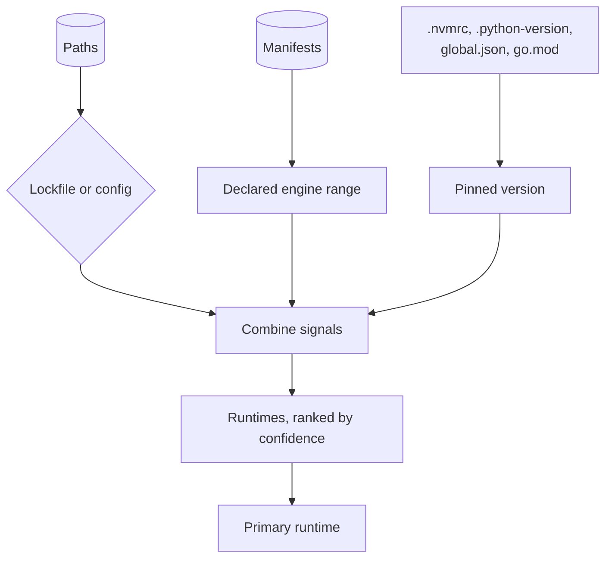

| #   | Item                    | Status | Notes                                                                |
| --- | ----------------------- | ------ | -------------------------------------------------------------------- |
| A   | Nine runtimes           | 🟡     | Node.js, Bun, Deno, Python, Java, PHP, Go, Rust, .NET                |
| B   | Version                 | 🟡     | From `engines`, `.nvmrc`, `.python-version`, `go.mod`, `global.json` |
| C   | Evidence and confidence | 🟡     | Same scoring as framework detection                                  |
| D   | Primary runtime         | 🟡     | The highest-confidence one, named explicitly                         |
| E   | Polyglot projects       | 🟡     | Several runtimes reported when several are genuinely present         |

**Bun and Deno are not suppressed by Node.** A Bun project still has a
`package.json`, so both are genuinely present — but `bun.lockb` is a much
stronger signal than a `package.json`, so Bun ranks above Node and becomes the
primary. Suppressing Node outright would be wrong: the project really is
Node-compatible.

**A runtime is not a language.** A repository can be 96% TypeScript and run on
Bun; 1.4 answers what it is written in, this answers what executes it.

**Not blocked.** Pure functions over the index and manifests.

### Delivered 2026-08-14

`lib/runtimes.ts` — **27 tests**. Wired through `analyzeProject` and shown on
the detection panel above frameworks.

**Verified against this project's real files:**

> **Node.js · 22.3.0 · certain**
> · `package-lock.json`
> · `.nvmrc`
> · `package.json` (shared with other runtimes)
> · version 22.3.0 pinned

Zero console issues.

**Decisions**

- **Strong and weak signals are labelled differently in the output.** A
  `package-lock.json` proves Node; a `package.json` merely suggests it, because
  Bun and Deno projects have one too. The UI says so rather than presenting
  both as equal evidence.
- **Bun and Deno rank above Node without suppressing it.** A Bun project really
  does have a `package.json` and really is Node-compatible — but `bun.lockb`
  is the stronger signal, so Bun becomes primary. Suppressing Node would state
  something false.
- **A pinned `.nvmrc` beats an `engines` range.** The former is what the
  project runs; the latter is what it tolerates.
- **Version files are read from a fixed short list**, so detection never widens
  into a second pass over the project.

### Toolchain — delivered 2026-08-14

`lib/toolchain.ts` — **23 tests**. Shown as a "How to run it" panel above the
language breakdown.

**Verified against this project:**

|            |                 |                  |
| ---------- | --------------- | ---------------- |
| Build      | `npm run build` | from the project |
| Develop    | `npm run dev`   | from the project |
| Production | `npm run start` | from the project |

npm identified from `package-lock.json`, `tsconfig.json` listed as runtime
configuration, no false conflict warning. Zero console issues.

**Decisions**

- **Every command says where it came from.** A declared script is fact; a
  convention is an educated guess. The badge distinguishes them, because a
  beginner cannot tell otherwise.
- **Nothing is invented.** With no script and no convention, the row reads "not
  found". A beginner running a command that does not exist is worse off than
  one told there isn't one.
- **The runner matters.** `npm run dev`, but `yarn dev` and `deno task dev` —
  emitting `npm run` for a yarn project would simply fail.
- **`packageManager` beats the lockfile.** The field is the project stating its
  intent; the lockfile is whatever happened to be committed.
- **Only Node lockfiles can conflict.** A Go project with `go.sum` beside a
  Node tool is normal, not a problem — flagging it would be noise.

**Gate:** a real project names its primary runtime, with a version where the
project pins one, and reports how to build, develop, and run it. ✅

---

## 1.7 Dependency detection — 🟡 delivered, except vulnerabilities

Specified 2026-08-14.

```mermaid
flowchart TD
    MAN[(Manifests)] --> DIR[Direct dependencies<br/>what the project chose]
    LOCK[(Lock files)] --> ALL[Every resolved package]
    DIR --> SPLIT{Compare}
    ALL --> SPLIT
    SPLIT --> T[Transitive<br/>pulled in by something else]
    DIR --> DEP{Known deprecated?}
    DEP -- yes --> WARN[Flagged with a replacement]
    DIR --> VULN{Advisory source configured?}
    VULN -- no --> UNKNOWN[["not checked" —<br/>never "none found"]]
    VULN -- yes --> SCAN[Query advisories]
```

| #   | Item                    | Status | Notes                                                |
| --- | ----------------------- | ------ | ---------------------------------------------------- |
| A   | Dependencies            | ✅     | Delivered in 1.3.2                                   |
| B   | Dev dependencies        | ✅     | Kept separate, as are peer dependencies              |
| C   | Versions                | ✅     | Declared ranges, verbatim                            |
| D   | Lock files              | ✅     | Delivered in 1.6                                     |
| E   | Package managers        | ✅     | Delivered in 1.6                                     |
| F   | Direct dependencies     | 🟡     | From the manifest — what the project asked for       |
| G   | Transitive dependencies | 🟡     | From the lock file, minus the direct ones            |
| H   | Deprecated packages     | 🟡     | Curated list, explicitly not exhaustive              |
| I   | Vulnerable packages     | ⬜     | **Deliberately not implemented offline — see below** |

**On vulnerable packages.** A real check needs a live advisory database (OSV,
the GitHub Advisory Database). Shipping a hardcoded list instead would mean a
project full of vulnerabilities reports "none found" — false assurance, which
is worse than no check at all.

So the interface exists and the UI has a distinct **"not checked"** state that
is never rendered as "no problems". Wiring an advisory source is a later step,
and it involves sending dependency names to a third party — egress the project
owner should opt into knowingly, given this codebase's rule that source never
leaves the machine.

**Deprecated packages are a curated list, and say so.** A short list of
widely-known retirements (`request`, `tslint`, `node-sass`) with their
replacements is genuinely useful to a beginner. The UI states it is not
exhaustive, for the same reason as above.

### Delivered 2026-08-14

| Piece                                              | File                                | Tests |
| -------------------------------------------------- | ----------------------------------- | ----- |
| Lock file parsing — npm, yarn, pnpm, Cargo, Go     | `lib/lockfiles.ts`                  | 13    |
| Direct vs transitive, deprecation, honest unknowns | `lib/dependency-report.ts`          | 17    |
| Dependency panel                                   | `components/dependency-summary.tsx` | —     |

**Verified against this project, checked against the real files:**

| Reported       | Ground truth           |
| -------------- | ---------------------- |
| Direct 35      | `package.json` has 35  |
| Runtime 24     | 24                     |
| Development 11 | 11                     |
| Transitive 698 | 733 unique − 35 direct |

**Counting is by unique package name, not lock file entries.** This project's
lock file has 822 entries but 733 distinct packages — npm installs several
versions of the same package at different depths. 733 is the number a person
means by "how many dependencies", and the UI now says "unique packages" rather
than implying entry count. A test pins the behaviour.

**The two honesty states**

- **Deprecation is a curated list**, and the panel says so — including when
  nothing matches: _"Nothing on that list is present — which is not the same as
  none being deprecated."_
- **Vulnerabilities are `not checked`**, never "none found". A hardcoded
  advisory list would tell a project full of vulnerabilities that it is clean.
  Wiring a real source (OSV, GitHub Advisory) means sending dependency names to
  a third party, which the project owner should opt into knowingly.

**Gate:** a real project reports what it depends on directly, what came along
for the ride, and is honest about what has not been checked. ✅ — with
vulnerabilities explicitly outstanding.

# Phases 2–29

Not yet specified by the project owner. What _is_ known is the 27-step build
order from [04-roadmap.md](04-roadmap.md) and the V2 backlog — reproduced here
so the path is visible, not because these are planned in detail.

### Toward the MVP chain

| Step | Item                        | Serves which MVP link | State |
| ---- | --------------------------- | --------------------- | ----- |
| 01   | Set up architecture         | —                     | 🟡    |
| 02   | Set up database             | all                   | ✅    | local stack, waves 1+2 (cloud pending)
| 03   | Set up authentication       | all                   | 🟡    | local stack live, flag on; D–G deferred
| 04   | Build workspace             | create project        | 🟡    | create/rename/delete + permissions persist; feed reads events; members/billing deferred
| 05   | Build project creation      | create project        | 🟡    | wizard + settings persist; list read path deferred
| 06   | Build project dashboard     | understand project    | ⬜    |
| 07   | Build local project import  | import project        | ✅    | scans save; import screen loads the saved scan back (final review round)
| 08   | Build codebase scanner      | detect stack          | ⬜    |
| 09   | Build framework detection   | detect stack          | ⬜    |
| 10   | Build technology detection  | detect stack          | ⬜    |
| 11   | Build project intelligence  | understand project    | ⬜    |
| 12   | Build roadmap engine        | generate roadmap      | ⬜    |
| 13   | Build task/step system      | guide developer       | ⬜    |
| 14   | Build documentation mapping | guide developer       | ⬜    |
| 15   | Build GitHub integration    | connect GitHub        | ⬜    |
| 16   | Build testing               | test                  | ⬜    |
| 17   | Build CI/CD                 | test                  | ⬜    |
| 18   | Build Supabase integration  | deploy                | ⬜    |
| 19   | Build Vercel integration    | deploy                | ⬜    |
| 20   | Build preview               | preview               | ⬜    |
| 21   | Build QA                    | preview               | ⬜    |
| 22   | Build production readiness  | deploy                | ⬜    |
| 23   | Build deployment            | deploy                | ⬜    |
| 24   | Build monitoring            | show health           | ⬜    |
| 25   | Build project health        | show health           | ⬜    |
| 26   | Test the entire journey     | the whole chain       | ⬜    |
| 27   | Launch MVP                  | —                     | ⬜    |

Every step maps to a link in the MVP chain. A step that serves no link does not
belong in v1 — see [04-roadmap.md](04-roadmap.md).

### After the MVP is proven

Feature traceability → releases → AI assistant → debugging → documentation
generation → learning system → templates → more integrations → team
collaboration → AI coding agent → automation.

Nothing on that list justifies work during v1. AI is third in V2, not in v1 —
it is a layer over structured project data, and the data has to exist first.

### How a phase gets added here

When the project owner specifies one, it is written up in the same shape as
0.1: scope, flow diagram, per-item 18-step checklist, gate, blockers. Nothing
is built before that write-up exists.
